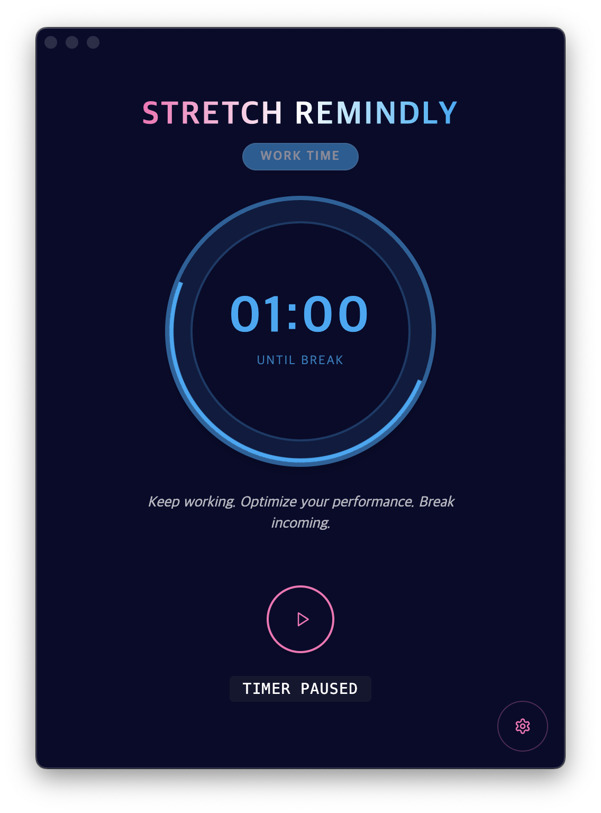
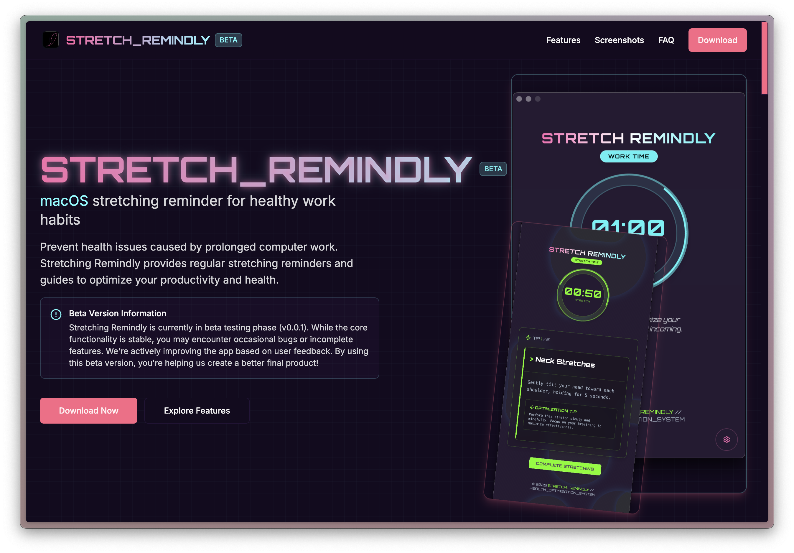
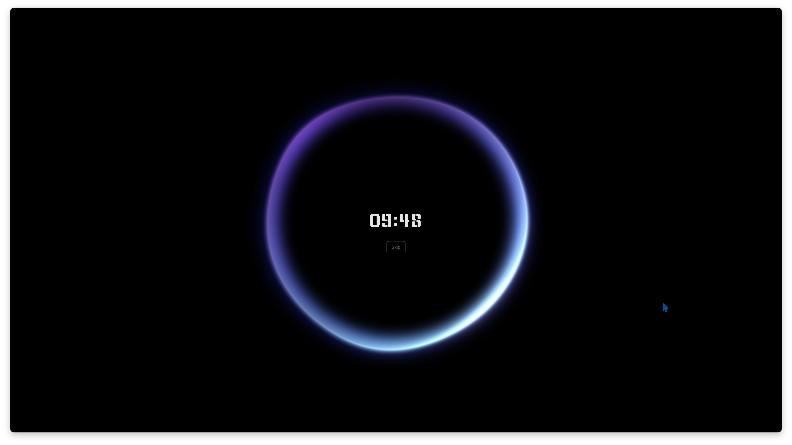
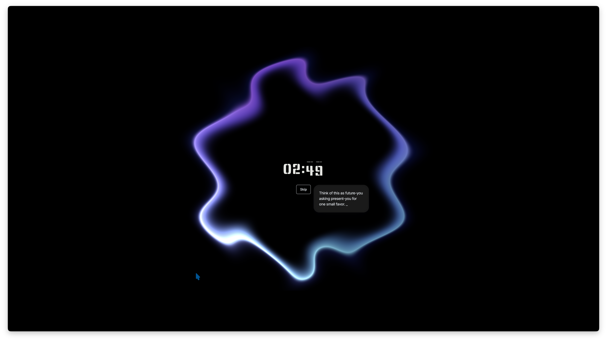
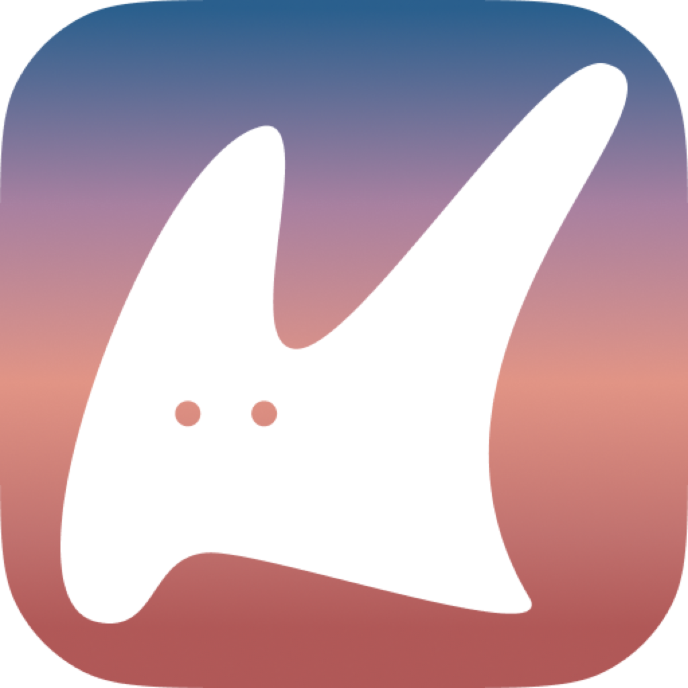
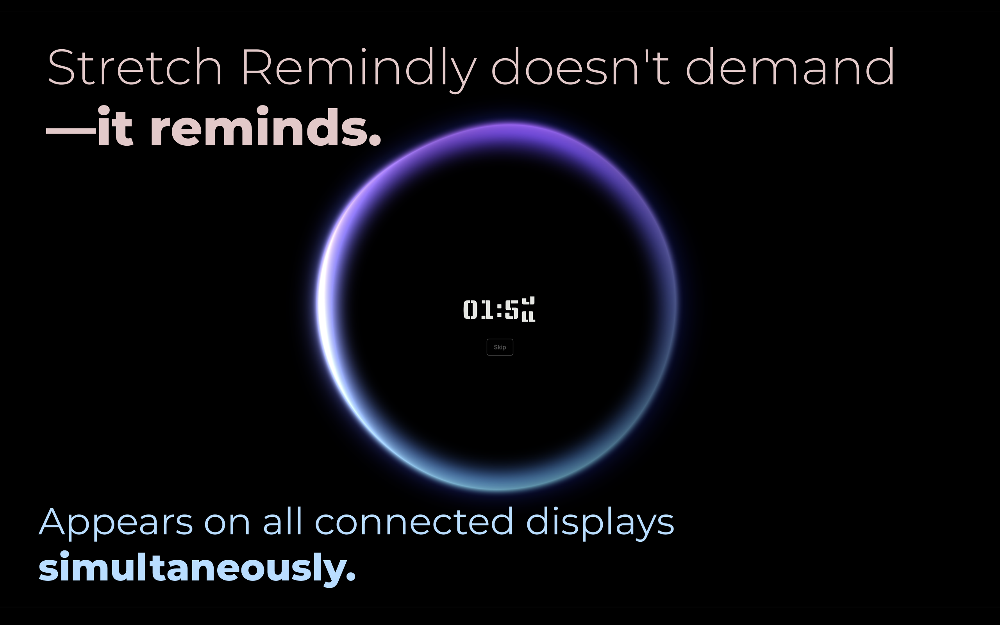
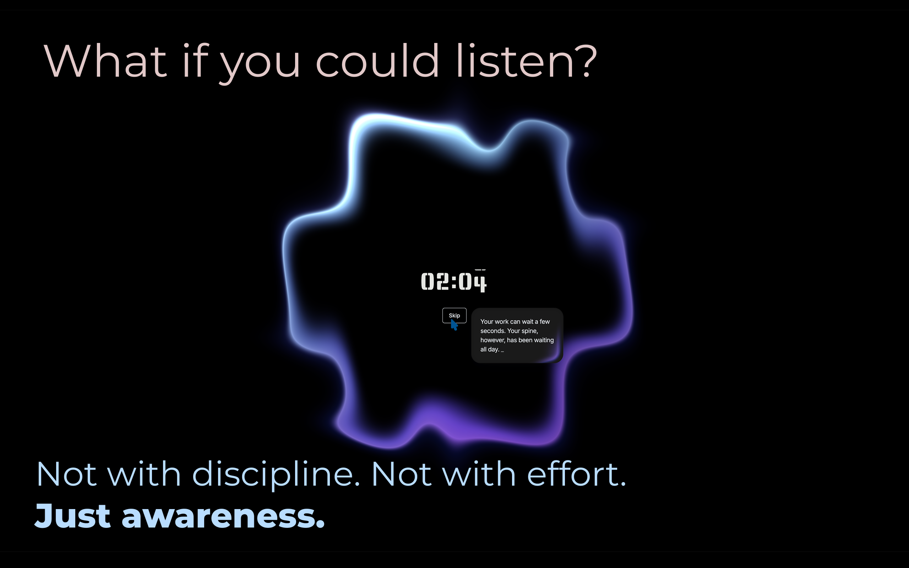
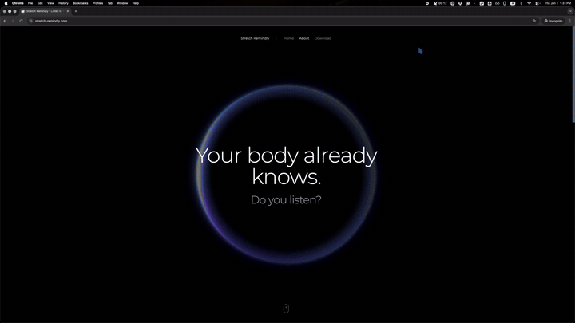
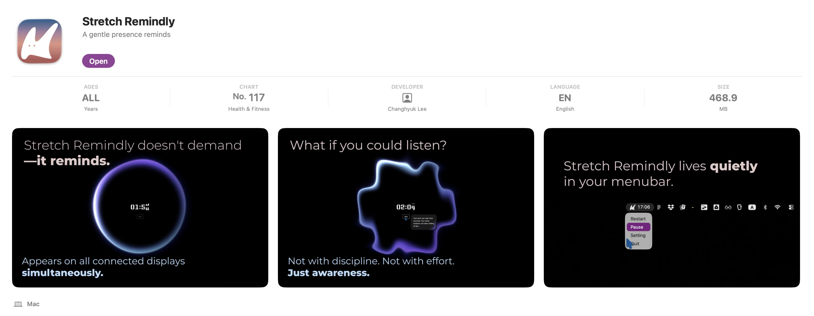
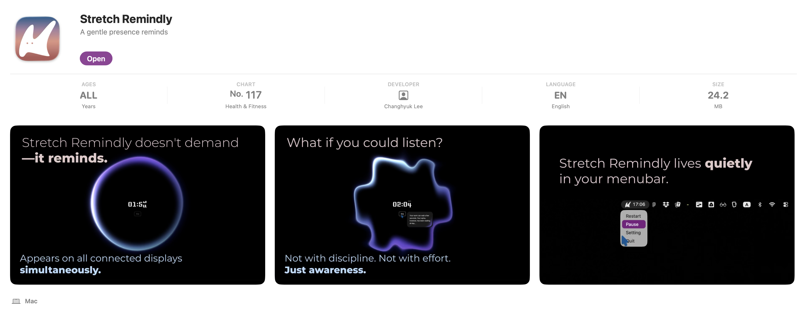

작년 4월에 시작한 프로젝트, **Stretch Remindly**에 착수한지도 정말 오랜 시간이 지났습니다. 기어코 2026년이 도래했군요.

정식으로 출시하거나 제대로 홍보한 적은 없지만, **Stretch Remindly**에도 많은 변화가 있었습니다. 디자인을 갈아엎고, 앱스토어에 출시하고, 결국 프레임워크까지 바꾸게 됐는데요. 이번 글에서는 그 과정을 정리하면서 **Stretch Remindly** 연재를 마무리하려고 합니다. 우선 디자인에 큰 변화가 있었어요.

꽤나 다양한 변천이 있었는데 현재 사진으로 남아있는 예전 모습은 요렇습니다.

(중간 버전들이 조금 더 있었는데 사진을 남기지 못했군요 😢)

이전 버전에서는 주로 사이버펑크틱한 색상과 다이내믹한 애니메이션을 보여줬다면, 지금은 릴렉스한 느낌을 주려고 합니다. 잠시라도 집중하고 몰입하던 화면에서 벗어날 수 있는 경험을 전달하고 싶었어요.

제품을 만들 때 먼저 컨셉을 정하는 것이 중요하단 사실을 알게 됐어요. 컨셉이야 언제든지 바뀔 수 있긴 하지만, 기획이나 디자인의 방향을 잡는 것이 훤씬 수월했습니다. **React Bits**에서 제공하는 요소를 여럿 활용했어요. 앞으로 테마를 더 추가할 예정인데, 기본 테마는 아마도 유지할 것 같습니다.

기능적으로도 작은 변화를 주었어요. 스트레칭 화면은 스트레칭을 생략할 수 있는 스킵 버튼도 보여주는데 사용자가 설정에서 스킵 버튼을 생략할 수 있도록 했어요. 한편, 스킵 버튼에 마우스를 올리면 스트레칭의 중요성을 일깨워주기도 합니다. 그리고 자잘한 디테일과 버그들을 수정했어요.

한편, 코드는 꽤나 많이 건드려야 했어요. [[vibe-coding|이전에 바이브코딩한 것]]을 바꾸고 유지보수하려다 보니 어려운 점이 많았습니다. 불필요한 코드를 걷어내고, 대대적인 리팩토링을 했어요. 바이브코딩의 부채를 실감했습니다. 그럼에도 요즘의 코딩 에이전트에게 작업을 위임할 때, 어느 정도 갖춰진 구조가 있다면 꽤나 잘 작동한다는 사실도 느끼고 있습니다. 이미 갖춰진 아키텍처나 테스트 코드가 있다면, AI가 이를 참고하기 때문에 큰 부채가 되는 코드를 많이 양산하진 않더군요.

근데 이 앱은 처음부터 이렇다 할 가이드 없이 순수 바이브코딩으로 만들었기 때문에 부채가 상당했어요. 결과적으로는 제가 일하기 좋은 환경을 만들기 위해 시간을 쏟아야 했습니다. 그리고 리팩토링 이후에는 AI에게 다시 많은 도움을 받고 있습니다. 그동안 코딩 에이전트도, 저의 프롬프팅도 발전해서일까요. 이제는 생산성에 도움이 된다고 느껴요.

앱을 다 개발했으니 출시를 해야 합니다. 잘 홍보할 자신은 없고, 무료 앱이기도 하니 가볍게 끌고 가고 싶은데요. 처음에는 **GitHub Artifacts**와 랜딩 페이지를 거쳐 다운로드를 제공했지만, 아무래도 사이트 유입이 있을 턱이 없죠. 그래서 앱스토어에 등록하기로 결정했습니다. 제가 그랬듯이 필요한 사람이 검색해서 받을 수 있도록 말이죠.

하지만 앱 출시를 위해 해야 할 것들이 너무 많다고 느꼈어요. 아이콘도 만들어야 하고, 앱스토어에는 정말 많은 절차와 관문이 있었어요. 앱 아이콘도 처음에는 AI로 만들어 보았습니다. **나노 바나나**를 써보기도 하고, [[../zt/literature/image-generation-model|ComfyUI에서 Flux 등을 사용한 워크플로우]]도 만들어 보았지만 제 마음에 드는 결과는 얻지 못했습니다.

나중을 위해서라도 앱 아이콘 정도는 직접 만들 수 있는 것이 좋겠다 싶어서, 피그마를 시작했어요. 피그마 공식 홈페이지에서 제공하는 튜토리얼을 따라하고 난 후 이런 형체 모를 아이콘을 만들었습니다.

이때 피그마를 조금이라도 배워둔 것이 이후에도 큰 도움이 되었어요. 트레이 아이콘을 바꾸고, 앱 스토어 출시를 위한 미디어 에셋을 피그마를 통해 만들었습니다. 앞으로도 생각한 것을 어렵지 않게 표현할 수 있을 정도까지는 배워보고 싶어요. 자주 쓰는 것이 상책이겠죠.

문구는 컨셉 카피를 따로 여러 버전으로 정리해 두고 골라 썼어요. "Your body already knows. Do you listen?" 같은 문장들인데, 앱을 소개하는 글이라기보다는 앱이 전하고 싶은 분위기를 담으려고 했습니다. 랜딩 페이지도 같은 톤으로 바꿨어요.

한편, 데모 영상을 만들기도 했습니다. Mac에서 기본 화면 녹화를 제공하기도 하지만, 클릭 이펙트를 주고 싶어서 **loom**이라는 앱으로 화면을 녹화했어요. 다른 여러 서비스들의 것이 그러하듯이, 줌인, 줌아웃 효과도 내고 싶었어요. 비디오 편집은 한번도 해본 적이 없어서 간편한 도구를 찾아봤지만 대부분 유료에다가 제가 원하는 것 이상으로 커다란 앱이 많았습니다.

그래서 그냥 Mac에서 기본적으로 제공하는 **iMovie**를 써보기로 합니다. 조금은 투박한 도구지만 여러 시행착오 끝에 원하는 영역을 줌 인아웃하는 것도 성공했어요.

앱스토어 등록 과정도 순탄하지만은 않았어요. 스크린샷과 소개 문구를 채우는 것은 물론이고, 수출 규정 관련 문서가 누락됐다는 메시지를 해결해야 했고, EU DSA 준수를 위한 문서를 요구받기도 했어요. 영문 등본까지 준비하고 있었는데, 어느 날 갑자기 메시지가 사라져서 허탈했던 기억이 납니다.

이번 경험을 통해서, 단 하나의 서비스를 출시하기 위해서 개발 외적으로도 해야하는 번거로운 일이 많다는 점을 배울 수 있었습니다. 그리고 이 과정을 통해 앞으로도 더 자주, 그리고 편리하게 앱을 출시할 수 있는 스킬과 경험을 갖추고 싶다는 생각을 했어요.

다행히도 앱 심사는 큰 어려움 없이 통과했고, **2026년 1월 7일** 드디어 앱스토어에 출시했습니다. 한 명의 유저라도 제가 만든 앱을 써준다면 감회가 남다를 것 같아요.

## Tauri로 갈아타기

출시하고 나서 가장 먼저 눈에 밟힌 건 용량이었어요. 설치 용량이 거의 **500MB**에 육박했는데, 이런 단순한 리마인더 앱의 크기로는 스스로도 용납하기 어려웠습니다. 크로미움을 내장하는 일렉트론의 한계이기도 하고, 심지어 MacOS의 두 아키텍처를 모두 지원하기 위해 유니버설 패키지로 빌드했기 때문이었는데요. 그래서 결국 **Tauri**로 갈아타기로 했습니다.

막상 시작하고 보니 생각보다 수월했어요. 화면은 대부분 순수 React 컴포넌트였고, Electron에 의존하는 부분은 IPC를 통해 메인 프로세스와 통신하는 일부 레이어에 모여 있었거든요. 리팩토링을 하면서 구조를 정리해둔 덕을 여기서 봤습니다.

이번에는 바이브코딩을 하던 때와 다르게 접근했어요. 먼저 코딩 에이전트와 함께 마이그레이션 계획 문서를 작성했습니다. 기존 Electron 앱의 구조를 분석하고, 그대로 재사용할 수 있는 코드와 수정이 필요한 코드를 나누고, 작업을 여러 개의 체크포인트로 쪼갰어요. 그리고 체크포인트 하나를 끝낼 때마다 직접 확인하고 커밋하는 방식으로 진행했습니다. Tauri는 처음이라서 낯선 부분은 따로 학습 노트로 정리하면서 따라갔어요. 그렇게 하루 만에 마이그레이션을 마칠 수 있었습니다.

결과는 꽤 만족스러웠어요. **468.9MB**였던 설치 용량이 **24.2MB**로 줄었습니다. 이후 업데이트를 거치면서 지금은 앱스토어 기준 **8MB** 남짓이에요. 이 정도면 리마인더 앱이라고 말해도 부끄럽지 않겠죠.

## 출시 이후

출시 후에도 몇 차례 업데이트를 했어요. 스킵 버튼에 마우스를 올렸을 때 보여주는 메시지를 다듬고, 설정 창을 마우스가 있는 디스플레이에 띄우도록 바꿨어요. 맥북을 덮었다가 다시 열었을 때 타이머가 꼬이는 문제를 고치고, 시간을 직접 입력해서 수정하는 기능과 사운드 옵션도 추가했습니다. 지금은 **2.3.0** 버전까지 나와 있어요.

## 마치며

작년 4월 바이브코딩으로 시작한 작은 사이드 프로젝트가 앱스토어 출시까지 오게 됐네요. 처음에는 AI가 만들어준 코드를 그대로 쓰다가 부채에 허덕이기도 했고, 개발 외적인 일들이 이렇게 많을 줄도 몰랐어요. 그래도 디자인, 영상 편집, 앱스토어 심사까지 하나씩 해보면서 앱 하나를 처음부터 끝까지 내놓는 경험을 할 수 있었습니다.

**Stretch Remindly** 연재는 이 글로 마무리하려고 해요. 앱은 앞으로도 제가 계속 쓰면서 조금씩 다듬어 갈 생각입니다.

혹시 오래 앉아서 일하신다면, 한 번 써보세요. 무료입니다.

[Stretch Remindly - App Store](https://apps.apple.com/app/stretch-remindly/id6757256808?mt=12)

**Stretch Remindly**를 많이 사랑해주세요. 감사합니다.

## 관련 문서
- [[vibe-coding|Stretch Remindly (1) - 바이브코딩]]: 바이브코딩으로 앱을 처음 만들었던 이야기
