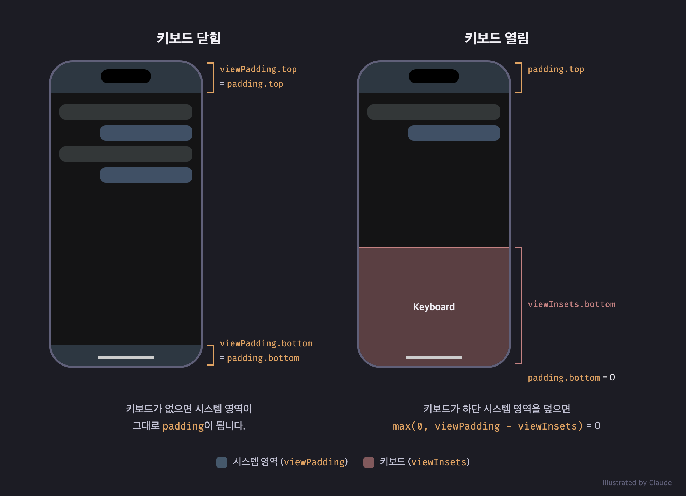
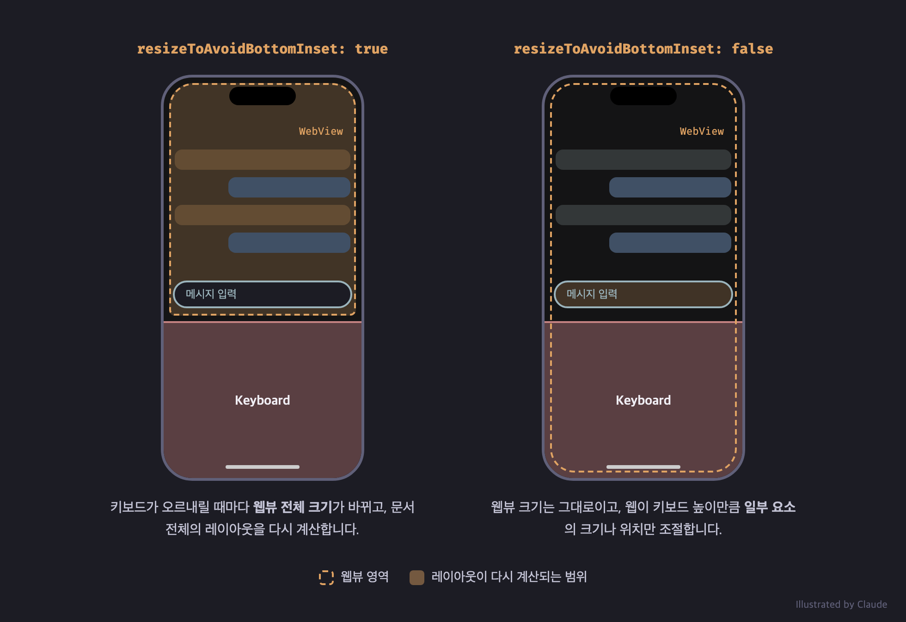
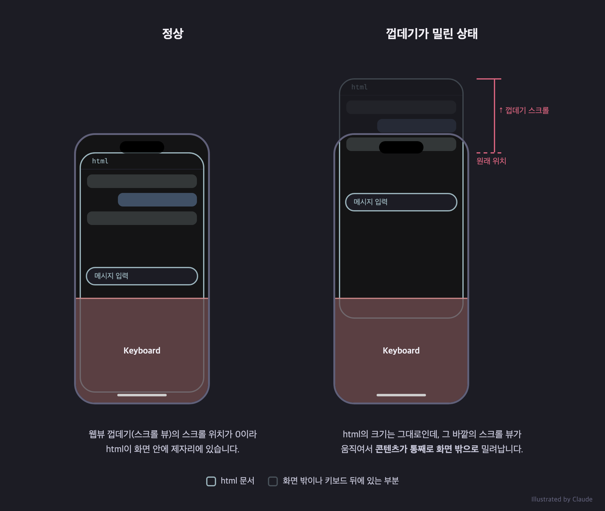
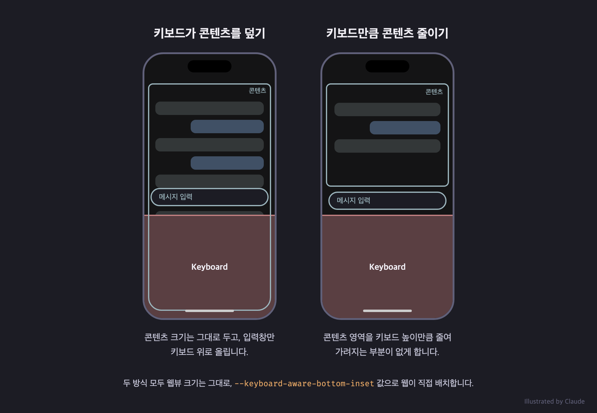

## 이 글에서는

회사에서 웹뷰로 채팅 화면을 만들면서, 키보드가 올라올 때마다 화면이 흔들리는 문제를 만났습니다. 원인을 쫓다 보니 SafeArea부터 웹뷰 바깥의 스크롤, 모바일 브라우저의 뷰포트까지 들여다보게 되었습니다. 이 글에서는 웹뷰를 처음 다루며 겪은 이 문제들과 해결 방법을 정리합니다. 기술 스택은 Next.js와 Flutter입니다.

미리 고백하자면 이 글에서 소개하는 문제 해결 방법은 최선이 아닐 가능성이 다분합니다. 저는 단순하면서도 더 좋은 방법이 있을 것이라고 기대하고 있습니다. 그럼에도 불구하고 적어도 제가 아는 사실과 경험을 되짚어 보고자 기록을 남깁니다.

## 웹뷰란?

웹뷰는 앱 화면 안에서 웹 페이지를 렌더링하는 컴포넌트입니다. 그렇다면 모바일 브라우저도 앱의 일종이니까 웹뷰를 사용하고 있을까요? 모바일 크롬이나 사파리는 각각 Chromium과 WebKit을 사용하고 웹뷰를 사용하지는 않습니다. 다만, iOS는 정책상 서드파티 브라우저에게 WebKit 사용을 강제하고([17.4부터 EU만 예외](https://developer.apple.com/support/alternative-browser-engines/)), 그래서 iOS 크롬은 `WKWebView`로 웹 콘텐츠를 그립니다. 따라서 웹뷰를 사용하는 모바일 브라우저 앱도 존재한다고 할 수 있겠습니다.

앱은 웹뷰에서 자바스크립트를 실행시키고 네트워크 요청을 가로챌 수 있습니다. 네이티브 코드와 메시지를 주고받을 수도 있죠. 이는 웹뷰와 브라우저를 가르는 기준이 되기도 합니다. 반면 브라우저로 열면 앱이 할 수 있는 일은 주소를 넘기는 것으로 끝입니다.

시스템 웹뷰로는 안드로이드의 [`android.webkit.WebView`](https://developer.android.com/reference/android/webkit/WebView)와 애플의 [`WKWebView`](https://developer.apple.com/documentation/webkit/wkwebview)가 있습니다. 전자는 패키지명과 달리 Chromium 기반입니다. 웹뷰는 같은 엔진의 브라우저가 제공하는 기능을 대부분 지원하지만 전부는 아닙니다. 예를 들어, 웹 푸시와 PWA 설치는 지원하지 않습니다. 그래서 MDN의 호환성 표에서도 WebView Android와 WebView on iOS를 별도 열로 표시합니다. 반대로 브라우저와 다르게 동작을 제어할 수도 있습니다. 대표적으로 웹뷰 설정에 따라 사용자 제스처 없이 미디어를 자동 재생하지 못하게 막는 정책을 비활성화할 수 있습니다.

[Custom Tabs](https://developer.chrome.com/docs/android/custom-tabs)와 [`SFSafariViewController`](https://developer.apple.com/documentation/safariservices/sfsafariviewcontroller)는 웹뷰가 아닙니다. 이 구성들은 앱 안에서 호출할 수 있지만, 실제로는 브라우저가 별도 프로세스에서 페이지를 그립니다. Custom Tabs는 크롬과 쿠키를 공유하고, `SFSafariViewController`는 iOS 11부터 사파리와 쿠키를 공유하지 않는다는 차이는 있습니다. 어느 쪽이든 앱이 페이지 내부에 개입할 수는 없습니다.

앱 개발 환경에서 웹뷰를 제공하는 여러 수단이 존재합니다. 이 글에서 다루게 될 Flutter에서는 [`webview_flutter`](https://pub.dev/packages/webview_flutter)(공식)나 [`flutter_inappwebview`](https://pub.dev/packages/flutter_inappwebview)(서드파티) 패키지로 시스템 웹뷰를 사용할 수 있습니다. 토스, 당근 등 국내 서비스도 화면 단위로 네이티브와 웹뷰를 나눠 쓰는 것으로 알고 있습니다.

## 웹뷰를 왜 쓸까?

웹뷰를 주요 스택으로 정하는 가장 큰 이유는 배포입니다. 자바스크립트로 만든 하나의 애플리케이션을 브라우저와 모바일 앱에 함께 올릴 수 있고, 네이티브 코드를 건드리지 않는 변경이라면 앱 심사를 기다리지 않고 갱신하거나 되돌릴 수 있습니다.

무심사 배포는 React Native 같은 프레임워크도 부분적으로 제공하지만, 이미 운영 중인 웹 서비스를 그대로 앱 화면으로 쓸 수 있다는 점은 웹뷰만의 장점입니다. 물론 웹뷰를 얹을 정도의 앱 개발은 필요합니다. 홍보 페이지나 링크 모음에 가까운 앱이라면 최소 기능 요건([App Store 심사 가이드라인 4.2](https://developer.apple.com/app-store/review/guidelines/#minimum-functionality))에 걸려 심사를 통과하지 못할 수도 있습니다. 그럼에도 앱 개발자를 따로 채용하지 않고 소수만으로 여러 플랫폼에서 동작하는 제품을 찍어낼 수 있다는 점은 분명한 이득입니다.

다만 어떤 비용이 줄어드는지는 구분해서 볼 필요가 있습니다. 줄어드는 것은 구현 비용입니다. 화면을 세 번 만들던 것을 한 번으로 줄일 수 있고, 이 절감 효과는 시간이 갈수록 누적됩니다. 플랫폼 사이의 스펙을 맞추던 조정 비용과 심사를 기다리는 시간도 줄어듭니다.

반면 **검증 비용은 줄어들지 않습니다**. 만들 곳이 하나로 줄었을 뿐, 그 코드는 여러 플랫폼에서 동작합니다. iOS 앱과 안드로이드 앱, 두 OS의 브라우저, 그리고 태블릿까지. 오히려 네이티브라면 없었을 비용이 늘어납니다. `WKWebView`와 사파리의 동작 차이, 기기마다 다른 안드로이드 웹뷰 버전, 그리고 브릿지의 하위 호환 등을 챙겨야 합니다. 네이티브로 나눠 개발하면 iOS 개발자가 iOS를, 안드로이드 개발자가 안드로이드를 확인합니다. 하지만 웹 개발자 한 명이 iOS 앱과 안드로이드 앱, 크롬과 사파리를 모두 봐야 한다면 총량은 그대로인 채 한 사람 몫이 됩니다. Playwright나 BrowserStack으로 일부는 자동화할 수 있지만 실기기에서만 재현되는 문제는 결국 사람이 확인해야 합니다.

그래서 웹뷰의 이득은 **만들 것이 많고 확인할 것은 적을 때** 크다고 볼 수 있습니다. 총 공수의 차이가 크지 않더라도 사람의 능력은 저마다 다르기 때문에 더 얻는 이득이 있기도 합니다. 채용이 어려운 네이티브 앱 개발자 한 자리를 기존 웹 개발자의 추가 시간으로 바꾸는 것은 작은 조직에는 실질적인 이득으로 이어질 수 있습니다. 동시에 [버스 팩터](https://en.wikipedia.org/wiki/Bus_factor)가 낮아지는 위험이기도 하지만 말이죠. 개발자와 회사의 입장이 갈리는 지점이라고도 할 수 있습니다.

다만 이 글에서 이런 문제를 깊게 다루려는 것은 아닙니다. 지금부터는 웹뷰로 간단한 채팅 UI를 구현하면서 겪었던 기술적인 문제를 회고하겠습니다.

## SafeArea 문제

SafeArea는 스마트폰 화면에서 상태바, 노치, 홈 인디케이터 등 시스템 요소에 앱 콘텐츠가 가려지지 않도록 확보한 여백을 의미합니다. Flutter에서는 기본 제공되는 `SafeArea` 위젯을 통해 이를 확보할 수 있습니다. 덕분에 시스템 요소는 콘텐츠를 가리지 않습니다. 다만 디자인 요구사항에 따라 SafeArea를 건드려야 할 때가 있습니다. 혹은 SafeArea가 없어야 하는 화면이 필요할 수도 있습니다. 결국 웹뷰에서 이런 요구사항에 유연하게 대처하기 위해서는 네이티브에서 SafeArea 설정을 꺼야 합니다. 그렇다면 앱 콘텐츠가 시스템 요소에 가려지는 문제는 어떻게 해결해야 할까요?

결론부터 말하자면, **웹이 그 책임을 가져가야 합니다**. 네이티브는 브릿지를 통해 웹으로 SafeArea의 높이를 전송하고, 웹은 이 정보를 받아 필요에 따라 여백을 확보하거나 무시합니다. 그러려면 먼저 네이티브에서 SafeArea 값을 알아내야 합니다.

Flutter에서 제공하는 [`FlutterView`](https://api.flutter.dev/flutter/dart-ui/FlutterView-class.html)는 Flutter 엔진 안에서 하나의 화면 출력 영역을 나타냅니다. 이 객체는 여러 메트릭 정보를 제공하며 주요 정보는 다음과 같습니다.

- `physicalSize`: 화면 영역의 실제 pixel 크기
- `devicePixelRatio`: 논리적 픽셀 대비 물리적 픽셀 비율
- `viewPadding`: 노치, 상태바 등으로 가려질 수 있는 고정 영역
- `viewInsets`: 키보드처럼 현재 콘텐츠를 완전히 가리는 영역
- `padding`: `viewPadding`과 `viewInsets`를 조합해 계산된 현재 사용 가능한 안전 여백

여기서 SafeArea는 `padding`이라고 볼 수 있습니다. `padding`은 `viewPadding`에서 `viewInsets`를 뺀 값이며, 0보다 작아지지 않습니다.

```
padding = max(0, viewPadding - viewInsets)
```

예를 들어 키보드가 열리기 전, 다시 말해 `viewInsets`가 0인 상황에서는 하단 시스템 네비게이션 바의 높이가 그대로 하단 `padding`이 됩니다. 반대로 키보드가 열려 `viewInsets`가 시스템 네비게이션 바의 높이를 넘으면 하단 `padding`은 0이 됩니다. `padding`을 통해 상하좌우의 여백을 모두 얻을 수 있는데, 보통 top과 bottom만으로 충분합니다.



`FlutterView`에서 제공하는 값들은 기본적으로 물리적 픽셀 단위입니다. 따라서 이 값을 그대로 넘기기보다는 논리적 픽셀로 변환하여 보내는 것이 편합니다.

```dart
final safeAreaTop = view.padding.top / view.devicePixelRatio;
```

Flutter 위젯 안에서는 아래처럼 [`MediaQuery.paddingOf`](https://api.flutter.dev/flutter/widgets/MediaQuery/paddingOf.html)로 논리적 픽셀 값을 바로 얻어낼 수도 있습니다. 하지만 저는 특정 위젯이 아닌 전역 `WidgetsBinding`에 observer를 등록하고, 메트릭이 바뀔 때마다([`didChangeMetrics`](https://api.flutter.dev/flutter/widgets/WidgetsBindingObserver/didChangeMetrics.html)) 값을 다시 계산해 보내는 방식을 사용하고 있어서 `FlutterView` 객체를 직접 다루고 있습니다.

```dart
final padding = MediaQuery.paddingOf(context);
```

값이 흘러가는 경로를 그려보면 다음과 같습니다. 뒤에서 다룰 키보드 높이(`viewInsets`)도 같은 경로로 전달됩니다.

```
Flutter                          Bridge         Web (CSS variables)
didChangeMetrics()
  padding    / devicePixelRatio ──┐
                                  ├──▶ state$ ──▶ --safe-area-top
  viewInsets / devicePixelRatio ──┘               --safe-area-bottom
                                                  --keyboard-aware-bottom-inset
```

웹에서는 브릿지를 통해 이 값을 구독하고 CSS 변수로 등록합니다.

```typescript
appBridge.state$.subscribe({
  onNext(state) {
    if (state.safeArea) {
      const root = document.documentElement;
      root.style.setProperty("--safe-area-top", `${state.safeArea.top}px`);
      root.style.setProperty("--safe-area-bottom", `${state.safeArea.bottom}px`);
    }
  },
});
```

이제 레이아웃 컴포넌트에서는 필요에 따라 이 값을 사용하면 됩니다. 단, 웹뷰 안에서 페이지가 새로고침되는 경우에는 주의해야 합니다. 브릿지가 다시 연결되는 동안 웹에서 설정한 여백이 순간 사라질 수 있기 때문입니다. 게다가 네이티브는 문서를 불러오는 동안 들어온 요청을 처리하지 못하고, 값이 바뀌지 않으면 다시 보내 주지도 않았습니다. 새로고침 직후에 한 번만 물어보면 여백이 0으로 남을 수 있는 것이죠. 그래서 저는 값을 받을 때까지 간격을 늘려가며(250ms, 500ms, 1초, … 최대 4초) SafeArea를 다시 요청하도록 했습니다. 가급적 앱을 사용하는 중에 웹 페이지가 새로고침되지 않도록 구현하는 것이 가장 좋겠지만, 그게 어렵다면 이런 보완책이 필요합니다.

## 키보드 문제

### 문제 현상과 원인

채팅 UI를 개발하면서 이런 문제를 만났습니다. 키보드가 나타나고 사라질 때마다 채팅 화면이 버벅이고, 특히 하단의 입력창이 위아래로 떨리는 현상이었습니다. 저는 이것을 단순하게 키보드 문제라고 부르겠습니다.

화면에 그려지는 DOM 요소가 많아질수록, 가령 [KaTeX](https://katex.org/)로 렌더링한 수식이 많거나 대화 내역이 길어질수록 이 현상이 두드러지게 나타났습니다. 메시지가 많은 것은 [`react-virtuoso`](https://virtuoso.dev/) 같은 DOM 가상화 라이브러리로 꽤나 해소할 수 있었지만, 하단에 배치된 입력창이 떨리는 현상은 크게 개선되지 않았습니다.

이 현상을 겪었을 당시에는 화면이 상당히 무겁고 복잡한 구조를 갖고 있었습니다. 그래서 웹에서 이러한 부분들을 개선하면 문제가 해결될 것으로 기대했습니다. 그런데 의심되는 요소를 하나씩 걷어내며 실험해 보니, **키보드가 오르내리면서 웹뷰 자체의 크기가 바뀌는 것이 근본적인 원인**이라는 사실이 드러났습니다.

대부분의 채팅 UI는 하단에 입력창을 배치합니다. 사용자가 입력창을 터치해 키보드가 올라오면 입력창은 키보드 바로 위에 놓여야 합니다. 웹뷰에서 이를 구현하는 가장 단순한 방법은 키보드가 올라올 때 웹뷰 크기 자체를 줄이는 것입니다. Flutter에서 화면의 뼈대가 되는 `Scaffold`는 [`resizeToAvoidBottomInset`](https://api.flutter.dev/flutter/material/Scaffold/resizeToAvoidBottomInset.html)이 기본으로 `true`입니다. 키보드가 올라온 만큼 body의 크기를 줄인다는 뜻입니다. 따라서 별도의 설정 없이도 웹뷰 크기를 줄이는 구현이 됩니다.

하지만 키보드가 나타나고 사라질 때마다 웹뷰가 줄어들고 늘어나는 것이 바로 문제의 원인이었기 때문에, 이제 이 방법은 쓸 수 없습니다.

### 리사이즈 책임을 웹으로

웹뷰 크기가 바뀌는 것이 원인이라는 사실을 알게 되었으니, 키보드에 따라 크기가 바뀌지 않도록 하면 어떨까요? 웹뷰를 감싸는 `Scaffold`의 `resizeToAvoidBottomInset`을 `false`로 바꾸면 되겠죠. 이제는 네이티브가 화면을 줄여주지 않기 때문에 그 책임을 웹이 가져가야 합니다.



웹은 키보드 높이를 알아야 합니다. 키보드 높이에 따라 필요하면 내부 DOM 요소를 줄이거나 늘릴 겁니다. 필요한 값은 앞서 언급한 `FlutterView`의 `viewInsets`에서 얻을 수 있습니다. SafeArea와 마찬가지로 논리적 픽셀로 변환해 같은 브릿지 상태에 담아 보내면, 웹은 SafeArea 값으로 여백을 확보했던 것처럼 이 높이를 CSS 변수(`--keyboard-aware-bottom-inset`)로 등록해 콘텐츠의 크기를 조절합니다.

웹뷰 크기가 통째로 바뀌는 것은 막았지만, 결국 이 방법도 내부적으로 DOM 크기를 바꿉니다. 그에 따라 Reflow가 발생하니까 값을 갱신할 때는 `requestAnimationFrame`을 사용했습니다. 값이 아무리 자주 들어와도 한 프레임에 한 번만, 그리고 이전 값과 달라졌을 때만 CSS 변수를 갱신하도록 했습니다.

그런데 이렇게 해도 간혹 버벅이는 순간이 있었습니다. 키보드가 올라오는 애니메이션 동안 네이티브는 거의 매 프레임 바뀐 `viewInsets`를 보내는데, 브릿지를 통한 메시지 전달은 비동기라서 웹은 네이티브보다 한두 프레임씩 늦게 따라갈 수밖에 없습니다. 그리고 높이가 바뀔 때마다 레이아웃 계산도 다시 일어나죠. 키보드 애니메이션이 끝난 뒤의 최종 높이만 반영하거나, 높이 대신 transform으로 움직이는 방법을 생각해 볼 수 있지만 아직 적용하지는 못했습니다.

### 또 다른 문제

"이제 잘 되겠지"라고 생각하던 중 또 다른 문제를 발견했습니다. 키보드가 나타나 있을 때 웹뷰 안의 fixed 요소를 잡고 위로 당기면 뷰포트에 위치한 UI가 통째로 화면 밖으로 밀려나는 현상이 있었습니다. 그런데 개발자 도구로 확인해 보면 HTML 요소의 크기 자체에는 아무 문제가 없었습니다. 크기는 멀쩡한데 DOM 요소가 실제로 화면을 벗어나고 있었던 거죠. 결국 HTML 바깥에서 벌어지는 일이라는 건데, 이미 Flutter에서 할 수 있는 것들을 다 했다고 생각하고 있었기에 막막했습니다.

그러던 중 `flutter_inappwebview`에서 스크롤을 막는 `disableVerticalScroll`, `disableHorizontalScroll` 설정을 발견했습니다. HTML과 무관하게 웹뷰라는 껍데기 자체가 스크롤될 수 있다는 뜻이었죠. 앞서 본 현상도 이것으로 설명됩니다.



그렇다면 이 설정을 켜면 문제가 해결될까요? 반은 맞고 반은 틀렸습니다. 저는 두 설정과 함께 오버스크롤을 막는 `disallowOverScroll`까지 켰습니다.

```dart
InAppWebViewSettings(
  disableVerticalScroll: true,
  disableHorizontalScroll: true,
  disallowOverScroll: true,
)
```

iOS에서는 이 설정만으로 웹뷰 껍데기가 스크롤되는 것을 막을 수 있었습니다. 문제가 되었던 fixed 요소를 잡고 위로 당기는 동작도 잘 막아 주었고, 웹 페이지 내부의 스크롤에는 큰 문제가 없었어요. 하지만 안드로이드에서는 웹 페이지 내부의 모든 스크롤까지 막혀 버리는, 그냥 넘어갈 수 없는 문제가 있었습니다. 플러그인의 [원본 코드](https://github.com/pichillilorenzo/flutter_inappwebview)를 보면 이렇습니다.

```java
// flutter_inappwebview_android, InAppWebView.java (원본)
setOnTouchListener(new OnTouchListener() {
  @Override
  public boolean onTouch(View v, MotionEvent event) {
    // ...
    if (customSettings.disableHorizontalScroll && customSettings.disableVerticalScroll) {
      return (event.getAction() == MotionEvent.ACTION_MOVE);
    }
    // ...
  }
});
```

이 패키지는 안드로이드에서 두 방향의 스크롤을 모두 막으면, 손가락을 움직이는 터치 이벤트(`ACTION_MOVE`) 자체를 소비해 버립니다. 이벤트가 웹 페이지까지 전달되지 않으니 내부의 다른 DOM 요소에서도 모든 스크롤이 막히는 것이죠. 이 사실을 알고 나서 `resizeToAvoidBottomInset`을 `false`로 설정한 결정을 철회해야 할지 고민했습니다. 하지만 그렇게 되면 키보드 문제의 근본적인 원인을 안고 가야 하고, 고통은 계속될 겁니다. 다른 팀원이 "버벅이는 거 고칠 수 없을까요?"라고 물었을 때 "아 그거 웹뷰라서 그래요. 그래도 최대한 개선한 겁니다."라며 얼버무리는 상황을 마주하고 싶지는 않았습니다. 화면을 개발할 때마다 이 한계를 고민해야 하는 것도 싫었고요. 그래서 몽키 패치를 검토했습니다.

```java
// 포크한 InAppWebView.java (요약)
public boolean onTouch(View v, MotionEvent event) {
  gestureDetector.onTouchEvent(event);
  // 터치가 시작될 때 현재 스크롤 위치를 기억해 둔다
  if (event.getAction() == MotionEvent.ACTION_DOWN &&
          (customSettings.disableHorizontalScroll || customSettings.disableVerticalScroll)) {
    syncScrollLockPosition();
  }
  // ...
  return false; // 터치 이벤트는 더 이상 가로채지 않는다
}

@Override
protected void onScrollChanged(int x, int y, int oldX, int oldY) {
  super.onScrollChanged(x, y, oldX, oldY);
  int lockedX = getLockedScrollX(x);
  int lockedY = getLockedScrollY(y);
  // 껍데기가 스크롤되었다면 기억해 둔 위치로 되돌린다
  if (!isRestoringScrollLock && (lockedX != x || lockedY != y)) {
    restoreLockedScroll(x, y);
    return;
  }
  // ...
}
```

핵심은 **터치 이벤트를 막지 않는다**는 것입니다. 원본은 터치 이벤트를 소비해서 스크롤을 원천 차단했다면, 패치한 코드는 터치 이벤트를 그대로 웹 페이지에 흘려보내고 웹뷰 껍데기의 스크롤 위치가 바뀌었을 때만 원래 위치로 되돌립니다. `onOverScrolled`에서도 같은 처리를 하고, 코드로 호출하는 `scrollTo`와 `scrollBy`도 고정된 위치를 벗어나지 않도록 했습니다. 덕분에 웹 페이지 내부의 스크롤은 살아나고, 껍데기는 사용자의 제스처든 코드에 의한 것이든 움직이지 않습니다. 두 방식을 비교하면 다음과 같습니다.

```
Original
  touch ──▶ onTouch(): consume ACTION_MOVE ──✕  page         (페이지 스크롤까지 막힘)

Fork
  touch ──▶ onTouch(): pass through ──────────▶ page         (페이지 스크롤 정상)
  shell scrolled ──▶ onScrollChanged() ──▶ scrollTo(locked)  (껍데기만 되돌림)
```

업스트림에 PR을 보내지는 않았고, 포크한 저장소에 반영했습니다. Flutter는 다음과 같이 의존성을 특정 git 저장소의 커밋으로 [덮어쓰는 수단](https://dart.dev/tools/pub/dependencies#dependency-overrides)을 제공합니다. `flutter_inappwebview`는 플랫폼별 패키지로 나뉘어 있어서, 안드로이드 패키지만 교체할 수 있었습니다.

```yaml
dependency_overrides:
  flutter_inappwebview_android:
    git:
      url: https://github.com/<fork>/flutter_inappwebview.git
      ref: <commit>
      path: flutter_inappwebview_android
```

이제 웹뷰 껍데기의 스크롤은 잘 차단되고 있습니다. 하지만 사용자가 직접 스크롤하지 않았는데도 껍데기가 자동으로 스크롤되는 경우라면 어떨까요? 안드로이드에서는 패치한 코드가 원인과 상관없이 껍데기의 스크롤을 되돌리기 때문에 이를 방지할 수 있습니다. 하지만 iOS는 패치 없이 플러그인의 기본 구현에 의존하고 있습니다. `flutter_inappwebview_ios`의 `InAppWebView.swift`를 보면 두 방향의 스크롤을 모두 막을 때 스크롤 뷰의 사용자 스크롤을 아예 꺼 버립니다.

```swift
scrollView.isScrollEnabled = !(settings.disableVerticalScroll && settings.disableHorizontalScroll)
```

그리고 스크롤 위치가 바뀌었을 때 이를 되돌리는 코드는 다음과 같습니다.

```swift
public func onScrollChanged(startedByUser: Bool, oldContentOffset: CGPoint?) {
    // ...
    if startedByUser {
        if disableVerticalScroll && disableHorizontalScroll {
            scrollView.contentOffset = CGPoint(x: lastScrollX, y: lastScrollY)
        }
        // ...
    }
}
```

`startedByUser`는 스크롤 뷰가 드래그 중이거나 감속 중인지(`isDragging || isDecelerating`)로 판단합니다. 즉, iOS에서 막히는 것은 **사용자의 제스처로 시작된 스크롤뿐**이고, 코드에 의해 일어나는 스크롤은 막지 못합니다. 대표적인 경우가 입력창에 포커스가 갈 때입니다. 입력창에 포커스가 가면 WebKit은 입력창이 보이도록 스크롤 뷰를 직접 움직이는데, 이 스크롤은 사용자가 시작한 것이 아니니 되돌려지지 않습니다. 그래서 iOS에서는 뷰포트가 밀리는 동작이 여전히 발생할 수 있습니다. 이 문제를 막는 몽키 패치를 iOS에도 적용하는 것이 더 근본적인 해결책일 수 있겠지만, 저는 기반 지식이 부족한 상태에서 위험한 변경은 최소화하고자 했습니다.

그래서 웹에서 포커스로 인한 자동 스크롤 자체를 일으키지 않는 방법을 택했습니다. `pointerdown` 이벤트에서 기본 동작을 막고, [스크롤 없이 직접 포커스를 주는](https://developer.mozilla.org/en-US/docs/Web/API/HTMLElement/focus#preventscroll) 것입니다. 코드는 대략 다음과 같습니다.

```tsx
const handlePointerDown = (
  event: React.PointerEvent<HTMLInputElement | HTMLTextAreaElement>,
) => {
  const input = event.currentTarget;

  // 이미 포커스된 요소라면 리턴
  if (document.activeElement === input) return;

  // pointerdown 기본 동작 취소
  event.preventDefault();

  // 스크롤 없이 직접 focus 호출
  input.focus({ preventScroll: true });
};

<textarea onPointerDown={handlePointerDown} />
```

이 코드를 반영한 뒤에도 한동안은 간혹 같은 현상이 보였습니다. 방법 자체에 한계가 있는 건가 싶었지만, 원인은 단순했습니다. 일부 입력 요소에 이 핸들러가 적용되어 있지 않았던 것이죠. 핸들러를 공용 유틸로 분리하고 빠짐없이 적용한 뒤로는 더 이상 문제가 재현되지 않았습니다.

### 앱에서의 결과

이제 앱에서는 제가 원하는 대로 동작합니다. 키보드가 오르내릴 때 웹뷰가 통째로 리사이즈되지 않기 때문에, 화면에 따라 키보드가 콘텐츠를 덮게 할 수도 있고 그만큼 콘텐츠를 줄일 수도 있습니다. 원하는 대로 고르면 됩니다.



물론 내부 DOM 요소의 일부가 줄어드는 것 또한 레이아웃 비용을 초래하는 건 사실입니다. 하지만 이 비용이 발생하는 범위가 예측 가능하고, 상대적으로 저렴합니다.

### 근데 모바일 브라우저에서는?

모바일 브라우저까지 고려하지 않아도 된다면 이 절은 건너뛰셔도 됩니다. 하지만 제가 만드는 제품은 모바일 브라우저까지 지원해야 했습니다. 키보드가 올라올 때 콘텐츠 크기를 줄이는 요구사항, 그리고 키보드가 나타난 상태에서 뷰포트가 밀리는 문제는 브라우저에도 그대로 남아 있습니다. 웹뷰 설정은 당연히 모바일 브라우저에 영향을 줄 수 없으니 웹 코드만으로 이 문제를 해결해야 합니다. 그래서 앞서 다룬 브릿지 로직은 앱 안에서만(`window.flutter_inappwebview`가 있을 때만) 동작하게 하고, 브라우저에서는 아래 방법을 사용합니다.

먼저 크기 문제부터 해결해보겠습니다. Viewport meta 태그는 뷰포트의 크기와 배율을 제어하는 방법을 제공하는데, 그중 [`interactive-widget`](https://developer.mozilla.org/en-US/docs/Web/HTML/Reference/Elements/meta/name/viewport#interactive-widget) 속성은 소프트 키보드 같은 요소가 나타날 때 브라우저가 뷰포트를 어떻게 조정할지 정합니다([Chrome의 설명](https://developer.chrome.com/blog/viewport-resize-behavior)). 다음과 같이 설정하면 키보드가 올라올 때 레이아웃 뷰포트 자체를 줄입니다.

```html
<meta name="viewport" content="width=device-width, initial-scale=1, interactive-widget=resizes-content" />
```

하지만 아쉽게도 이건 반쪽짜리 해결책입니다. **iOS 사파리에서는 지원하지 않는** 기능이기 때문이죠. 그래서 다른 방법을 생각해야 합니다. 모바일 브라우저에서 키보드가 열려도 레이아웃 뷰포트의 높이인 `window.innerHeight`는 대체로 유지되고, 실제로 보이는 영역인 [`visualViewport.height`](https://developer.mozilla.org/en-US/docs/Web/API/VisualViewport)가 줄어듭니다. 이 점을 이용합니다.

```
┌─────────────────────┐ ┬              ┬
│    (out of view)    │ │ offsetTop    │
├─────────────────────┤ ┼              │
│                     │ │              │
│   Visual viewport   │ │ height       │ window.innerHeight
│                     │ │              │
├─────────────────────┤ ┼              │
│       Keyboard      │ │ insetBottom  │
└─────────────────────┘ ┴              ┴
```

하단에서 키보드에 가려진 영역은 다음 공식으로 구합니다.

```javascript
const insetBottom = Math.max(
  0,
  window.innerHeight - visualViewport.height - visualViewport.offsetTop,
);
```

`offsetTop`을 빼는 이유는 포커스로 인해 visual viewport가 위로 이동한 만큼을 키보드 높이로 잘못 계산하지 않기 위해서입니다. 다만 `visualViewport`의 높이는 키보드가 아니어도 주소창이 접히거나 펼쳐질 때 바뀝니다. 그래서 편집 가능한 요소에 포커스가 있고, 높이가 120px 넘게 줄었으며, 처음 높이의 85% 미만으로 줄었을 때만 키보드가 열린 것으로 판단했습니다. 이제 이 값을 웹뷰에서와 같이 CSS 변수로 등록하여 사용하면 됩니다.

일관성을 위해 Viewport meta 태그 없이 이 방식만 적용하는 것도 가능하겠지만, 안드로이드에서는 Viewport meta 태그를 사용하는 것이 더 안정적이기 때문에 둘 다 반영하는 것을 권장합니다. 두 방식은 충돌하지도 않습니다. 안드로이드에서 `interactive-widget`이 적용되면 `window.innerHeight` 자체가 키보드만큼 줄어들기 때문에, 위 공식으로 계산한 값은 0이 됩니다.

이제 스크롤 문제가 남았습니다. 이건 다소 단순하고 무식한 방법밖에 찾지 못했습니다. 브라우저의 동작 자체를 바꿀 수는 없기 때문입니다. 키보드가 열리면 루트 요소의 스크롤을 막고, 그래도 스크롤이 일어나면 즉시 맨 위로 되돌립니다.

```tsx
const lockRootScroll = () => {
  const root = document.documentElement;
  const previousOverflow = root.style.overflow;

  const resetScroll = () => {
    if (window.scrollY !== 0) {
      window.scrollTo(0, 0);
    }
  };

  root.style.overflow = "hidden";
  resetScroll();
  window.addEventListener("scroll", resetScroll);

  return () => {
    root.style.overflow = previousOverflow;
    window.removeEventListener("scroll", resetScroll);
  };
};
```

이 잠금은 앱 밖의 모바일 브라우저에서, 키보드가 열려 있는 동안에만 적용합니다. 이 방식의 한계는 스크롤이 먼저 일어난 뒤에 되돌리기 때문에 화면이 순간적으로 밀렸다 돌아오는 현상이 남는다는 점입니다. 사실상 iOS 사파리를 위한 미봉책에 가깝고, fixed 요소와 관련해서는 더 좋은 방법이 있을 것 같아 계속 찾아보고 있습니다.

## 마치며

정리해 보면 이 글에서 다룬 문제와 해결 방법은 다음과 같습니다.

| 문제 | 원인 | 해결 |
| --- | --- | --- |
| SafeArea | 유연한 레이아웃을 위해 네이티브 SafeArea를 끔 | 브릿지로 값을 전달하고 CSS 변수로 여백 확보, 새로고침 시 재요청 |
| 키보드에 따른 버벅임 | 키보드가 오르내릴 때마다 웹뷰 크기가 바뀜 | `resizeToAvoidBottomInset: false`, 키보드 높이를 웹에 전달해 웹이 직접 크기 조절 |
| 웹뷰 껍데기 스크롤 | HTML 바깥, 웹뷰 자체의 스크롤 | 스크롤 차단 설정, 안드로이드 플러그인 패치, 포커스 시 `focus({ preventScroll: true })` |
| 모바일 브라우저 | 웹뷰 설정을 쓸 수 없음 | `interactive-widget`, `visualViewport`로 키보드 높이 계산, 루트 스크롤 잠금 |

돌아보면 이 문제들은 모두 같은 결정에서 출발했습니다. **레이아웃의 책임을 네이티브에서 웹으로 가져온 것**이죠. 그 덕분에 웹은 키보드와 시스템 영역을 직접 다룰 수 있게 되었지만, 동시에 네이티브가 대신 해주던 일과 그 일이 어떻게 동작하는지까지 알아야 했습니다. 결국 플러그인 내부의 자바와 스위프트 코드를 읽고, 포크까지 하게 되었으니까요.

앞에서 웹뷰를 쓰면 구현 비용은 줄어도 검증 비용은 줄지 않는다고 적었는데, 이번 경험이 딱 그랬습니다. 대부분의 문제는 실기기에서만 재현되었고, iOS와 안드로이드, 앱과 브라우저에서 모두 다르게 동작했습니다. 그리고 포크한 플러그인처럼, 해결책 중 일부는 앞으로 계속 유지해야 하는 비용으로 남았습니다.

아직 남은 과제도 있습니다. 키보드 애니메이션 중 간혹 남는 버벅임, 모바일 브라우저에서 스크롤을 되돌리기 전 순간적으로 밀리는 현상, iOS에도 플러그인 패치가 필요한지, 그리고 안드로이드 패치를 업스트림에 기여할지 여부입니다. 서두에 말씀드렸듯 이 글의 방법들이 최선은 아닐 겁니다. 더 단순하고 좋은 방법을 알고 계신다면 꼭 알려주세요. 새로 알게 되는 것이 있다면 이 글도 계속 고쳐 나가겠습니다.
