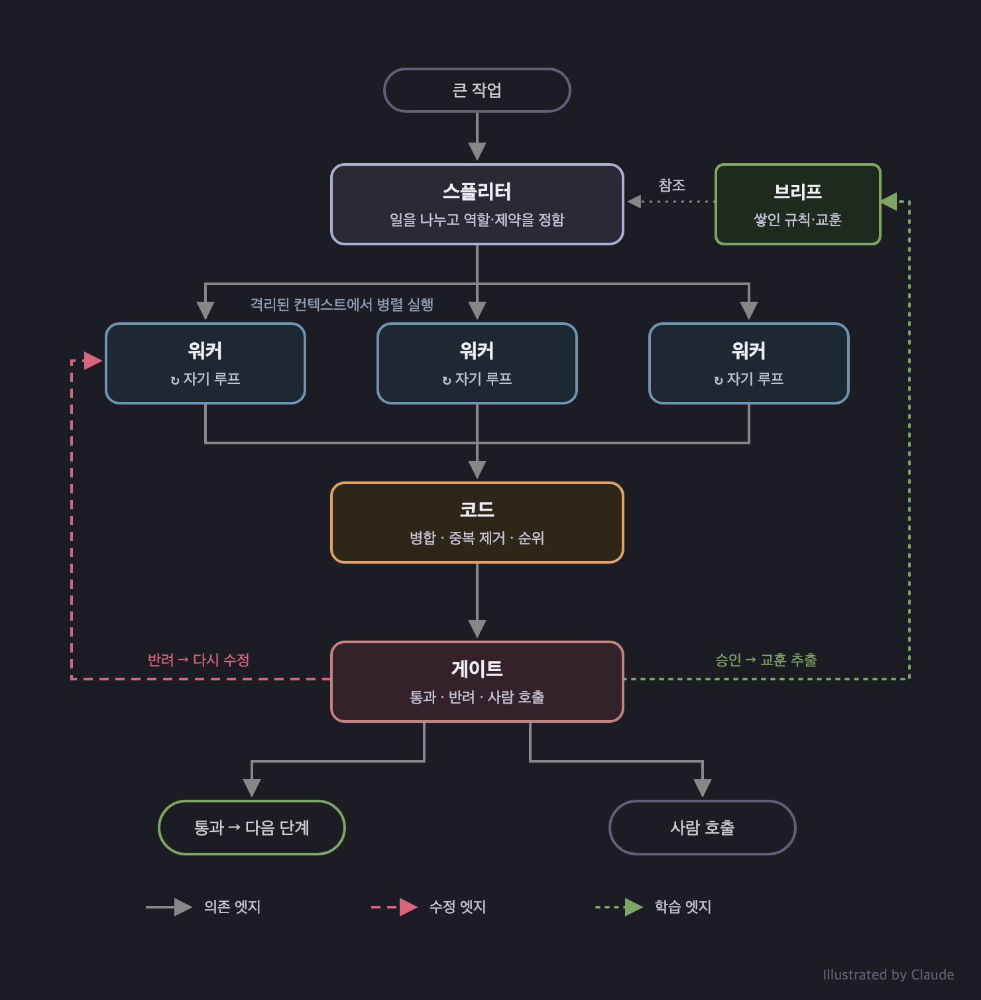

## Loop

AI한테 코드 작성을 요청한다. 보통은 이렇다.

1. AI가 코드를 작성하고
2. 사람이 확인한다.

여기서 사람은 코드를 확인하는 역할이다. 여기서 사람을 빼려면, 이런 구조가 필요하다.

1. AI가 코드를 작성하고
2. AI가 검사한다.
3. 검사가 실패하면 AI가 고치는데
4. 검사가 통과할 때까지 2~3을 반복한다.

```
Before:
  write ──▶ human review

After:
  write ──▶ check ──(pass)──▶ done
    ▲         │
    └── fix ◀─┘  (fail)
```

이게 **루프**(Loop)다. **사람이 빠져도 결과물이 개선된다**. 2번은 단위 테스트, 통합 테스트, E2E 테스트, 정적 분석, 그리고 에이전트의 코드 리뷰가 될 수도 있다.

사실 요즘 나오는 코딩 에이전트들이 이 정도는 기본으로 갖추고 있다.

## 루프가 못하는 일

루프는 주어진 작업 하나를 잘 수행하는 편이지만 아쉬운 점이 있다.

- 큰 작업을 어떻게 나눌지
- 어떤 작업을 먼저 할지
- 어떤 작업들을 동시에 병렬적으로 수행할지

사람이 자주 개입해야 하고, 덜 개입하려면 **루프만으로는 부족하다**. 이때 그래프가 필요하다.

## Graph

그래프는 **노드**와 **엣지**로 구성된다. 노드는 작업 단위 하나를 일컫는다. 엣지는 노드 간의 연결이다.

글에서 말하는 노드는 4가지다.

- **스플리터(Splitter)** - 일을 분배한다.
- **워커(Worker)** - 일을 수행한다.
- **코드(Code)** - 이름 그대로, 코드로만 동작한다.
- **게이트(Gate)** - 결과를 보고 다음에 무엇을 할지 정한다.

이러한 노드는 엣지로 연결된다.

- **의존 엣지(Dependency edge)** - 이 노드의 출력을 저 노드가 입력으로 읽어야 할 때 이어준다.
- **수정 엣지(Correction edge)** - 게이트가 실패한 작업을 해당 노드에게 다시 요청할 때 이어준다.
- **학습 엣지(Learning edge)** - 결과를 승인한 후 지난 작업에서 얻었던 교훈을 스플리터에게 전달하고 싶을 때 이어준다.



### Splitter

> 예시. 관점에 따라 코드 리뷰를 병렬로 맡긴다.

스플리터는 큰 작업 하나를 받아서 워커들이 각자 처리할 수 있는 단위로 바꾼다. 스플리터의 입력은 '이 기능을 만들어줘'가 될 수 있다. 스플리터는 다음을 정한다.

- 어떤 작업을 하고, 하지 않을지
- 작업을 몇 조각으로 쪼갤지
- 작업을 어떤 경계로 나눌지
- 각 워커가 어떤 역할을 수행할지
- 각 워커가 어떤 제약을 가질지

스플리터는 **다른 어떤 노드보다 많은 결정을 한다**. 스플리터는 에이전트일 수도 있고, 단순 코드가 될 수도 있다. 결정의 기준에도 정답은 없다. 병렬 구현을 시킬 때는 서로 작업 영역을 침범하지 않도록 폴더 구조로 일을 나눌 수도 있다. 하지만 이조차도 프로젝트의 아키텍처에 따라 달리 결정될 수 있다.

처음부터 완벽한 기준을 세우는 것은 어려워 보인다. 그래프를 돌리면서 후술하게 될 학습 엣지를 통해 여러 교훈(글에서는 brief라고 표현되는)이 기준에 추가될 수 있다.

명확한 정답은 없지만 오답을 감지할 수 있는 신호는 있다.

- 워커들이 같은 파일을 수정하다가 충돌한다면, 순서가 필요한 작업을 병렬로 시키는 것이 아닐지
- 여러 리뷰어의 지적이 같은 곳에 쏠린다면, 관점이 충분히 나뉘지 않았거나 컨텍스트를 공유하고 있는 것이 아닐지
- 워커가 같은 문제를 계속 고치는 데 실패한다면, 스플리터가 작업을 제대로 나누지 못하는 것은 아닐지
- 순서대로 배치된 워커가 선행 노드에서 받는 것이 없다면, 병렬로 시켜도 되는 일을 직렬로 만든 것이 아닐지

### Worker

> 예시. 리뷰 에이전트는 격리된 컨텍스트 하에서 주어진 관심사에 따라 코드를 검토한다.

워커는 주어진 일을 수행한다. 구현 세션 하나, 코드 리뷰어 세션 하나, 이런 것들이 워커가 될 수 있다. 워커는 각자의 컨텍스트와 루프를 갖는다. 구현 워커는 코드를 짜고, 테스트를 돌리고, 실패하는 케이스를 고친다. 워커들이 컨텍스트를 공유하면 그 결과가 수렴될 수 있기 때문에 이를 **격리하는 것이 중요하다**. 

### Code

> 예시. 여러 에이전트의 산출물을 기계적으로 병합한다.

코드는 이름 그대로 에이전트가 아닌 스크립트와 같은 일반 코드가 실행되는 노드다. 글에서는 '사람들이 존재를 잊는 노드'라고 표현한다. 이런 작업들이 해당될 수 있다.

- 병합
- 순위 매기기
- 중복 제거
- 전후 비교

**기계적으로 해결할 수 있는 부분은 코드로 해결한다**. 토큰을 덜 쓰거나, 시간 지연을 감소시킬 수 있다. 또한 AI의 변덕을 걱정하지 않고 기대하는 결과를 안정적으로 얻을 수도 있다.

### Gate

> 예시. 어떤 변경은 사람이 승인한다.

게이트는 워커의 결과를 보고 다음에 무엇을 실행할지 결정한다. 출력은 3가지 중 하나이다.

- 통과(pass) - 다음 단계로 진행한다.
- 반려(reject) - 실패한 단위를 수정 엣지를 통해 해당 워커로 돌려보낸다.
- 또는 사람을 호출한다.

따라서 게이트에는 판단 기준이 있어야 한다. 기준을 세울 때는 '**예상되는 통증**'을 참고한다. 즉 맞으면 얼마나 아플지 상상해 본다.

| 예상되는 통증 | 예시 | 게이트 | 경로 |
| --- | --- | --- | --- |
| 되돌리기 쉽고 영향이 좁음 | 문구 수정, 커버리지 있는 작은 함수 | 테스트 통과 시 자동 통과 | 열린 경로 |
| 되돌릴 수 있지만 영향이 넓음 | 공유 유틸, 스키마 변경 | 테스트 통과 + 궤적이 깨끗해야 함 | 열린 경로 |
| 되돌리기 어려움 | 마이그레이션, 삭제, 결제 | 사람을 거침 | 닫힌 경로 |

'궤적(trajectory)이 깨끗하다'라는 표현을 하는데, 열린 경로에서 봐야 하는 단서 중 하나이다.

열린 경로에서는 아래의 단계를 거치며 단서를 찾는다.

1. 결정적(deterministic)인 결과(테스트, 정적 분석, E2E 등)
2. 이번 실행의 궤적(몇 번 고쳤는지, 범위 밖 파일을 건드렸는지)
3. 같은 유형의 작업이 과거에 롤백된 빈도
4. 에이전트의 평가

예를 들어, 되돌릴 수 있지만 영향이 넓은 작업은 이 단계를 모두 통과해야 머지될 수 있다. 근데 여기서 2번, 3번 단서를 게이트가 알 수 있으려면 히스토리가 쌓이는 구조를 만들어야 한다.

게이트는 코드, 모델, 사람이 섞여서 구성될 수 있다.

- 코드 - 결정적인 판정(테스트 통과, 스코프 위반, 시도 횟수)
- 에이전트 - 코드로 거르기 힘든 평가
- 사람 - 닫힌 경로, 그리고 코드와 LLM이 검증하기 어려운 영역 확인

### Correction

> 예시. 코드 리뷰를 통과하지 못했다면, 다시 고치라고 지시한다.

통과하지 못하면 게이트는 반려한다. 수정 엣지를 통해 해당 워커에게 수정을 요청한다.

반려에는 아래 내용이 포함된다.

- 판정(verdict)과 이유 - 무엇이 실패했나?
- 증거(evidence) - 기대값, 실제값, 에러가 난 파일과 줄
- 범위(scope) - 이 파일만 고쳐라!

최대 횟수를 정하는 것도 고려할 수 있다. 가령 최대 3회 시도를 하고 계속 실패한다면 거기서 멈춘다. 그리고 **워커가 아닌 스플리터에게** 계획 수정부터 다시 요청한다.

```
worker ──▶ gate ──(reject: verdict, evidence, scope)──▶ worker   (최대 3회)
            │
            └──(3회 실패)──▶ splitter   (계획부터 다시)
```

### Learning

> 예시. 이번 작업에서 알게 된 제약사항을 스플리터와 워커의 작업 기준에 넣는다.

게이트에서 통과해도 끝이 아니다. 승인 결과는 학습 엣지의 재료가 된다. 결과에서 제약을 뽑아 스플리터의 브리프로 보낸다. 게이트는 **일의 끝이자 학습의 시작**인 셈이다. 승인 이력에는 수정 없이 통과한 횟수, 나중에 롤백된 횟수 등이 기록될 수 있다. 

학습은 다음과 같이 흘러간다.

```
run record        handlers 1회차 실패, 2회차 통과
    │
    ▼
constraint        암묵적 동작은 명시적으로 지정한다
    │
    ▼
brief             스플리터 브리프에 규칙 추가
    │
    ▼
next run          스플리터와 워커가 처음부터 규칙을 읽음
```

글에서는 이런 예시를 보여준다.
```
ACCEPTED   utils 슬라이스 포팅, 첫 시도에 green
DERIVED    어댑터는 키워드 인자를 그대로 보존한다
LANDS IN   이후 모든 슬라이스에 대한 스플리터의 브리프
```

너무 단순한 예시라서, 클로드한테 가정을 좀 더 해보라고 했다.

코드를 슬라이스 단위로 다른 프레임워크로 포팅하는 작업에서 `handlers` 슬라이스가 두 번 만에 통과

```
UNIT       handlers 슬라이스
VERDICT    green (2회차에 통과)
ATTEMPTS   1회차 red: test_auth_redirect
                 expected 302, got 200, handlers/auth.py:88
           2회차 green
CHANGE     리다이렉트 응답을 반환하는 대신 암묵적으로 200을 반환하던
           부분을 명시적 302 반환으로 수정
GATE       테스트 통과, 범위 위반 없음, 시도 2회
```

게이트는 위 기록을 보고 이런 규칙 후보를 작성한다. (혹은 별도 추출 전용 노드를 두는 것도 가능하다.)
```
CONSTRAINT  원본 프레임워크에서 암묵적으로 처리하던 동작(리다이렉트,
            기본 상태 코드 등)은 대상 프레임워크에서 명시적으로 지정한다
SCOPE       handlers 계열 슬라이스
EVIDENCE    handlers 슬라이스 1회차 실패 (auth.py:88)
CONFIDENCE  후보 (이 유형의 실패 1건)
```

이 제약이 들어가는 곳은 스플리터의 브리프다. 브리프는 스플리터가 일을 나눌 때 참조하는 문서에 들어간다.

반영 전
```
# 포팅 브리프
- 슬라이스는 모듈 의존성이 적은 것부터 진행한다
- 슬라이스마다 별도 워크트리에서 작업한다
- 어댑터는 키워드 인자를 그대로 보존한다
```

반영 후
```
# 포팅 브리프
- 슬라이스는 모듈 의존성이 적은 것부터 진행한다
- 슬라이스마다 별도 워크트리에서 작업한다
- 어댑터는 키워드 인자를 그대로 보존한다
- 원본에서 암묵적으로 처리하던 동작(리다이렉트, 기본 상태 코드 등)은
  대상 프레임워크에서 명시적으로 지정한다.
  (handlers 계열 슬라이스에 적용. 근거: handlers 1회차 실패)
```

이 브리프는 스플리터와 워커 모두에게 영향을 끼친다. 스플리터는 좀 더 신중하게 워커를 분류할 것이고 워커는 처음부터 이 규칙을 읽고 시작하니 같은 실패를 겪지 않을 수 있다.

## 기타

- 글에서는 세부사항에 대해 많이 언급하지 않아서 설계에 따라 디테일이 달라질 여지가 많아 보인다. 가령, 검사를 게이트가 하게 할 것이냐, 워커가 자신의 루프에서 하게 할 것이냐, 혹은 둘 다 하게 할 것이냐 등등
- 각 노드가 읽고 쓰는 맥락 정보를 잘 만드는 것도 설계상 큰 고민이 될 것 같다.


## 참고

- [Loops and Graphs: how to stop babysitting agents and only approve the last step](https://x.com/hanakoxbt/status/2091515787366306154)